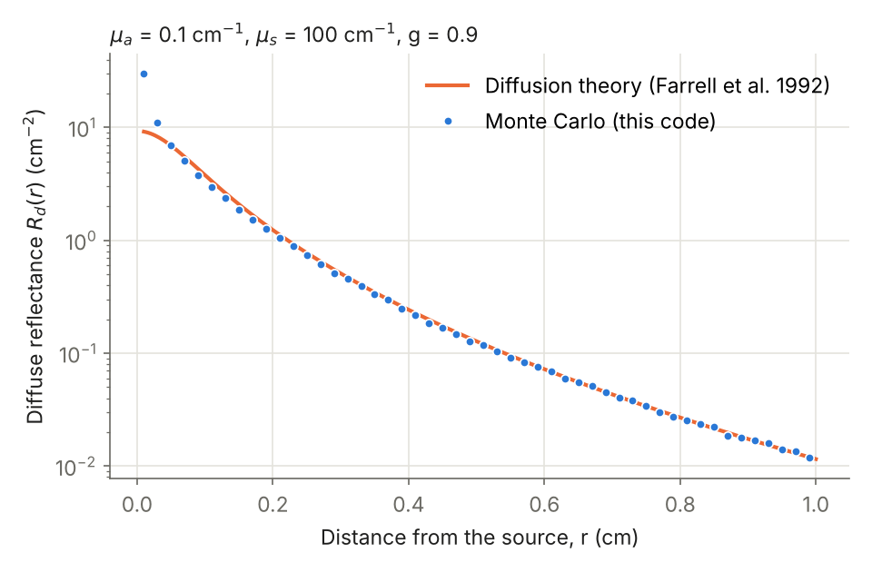
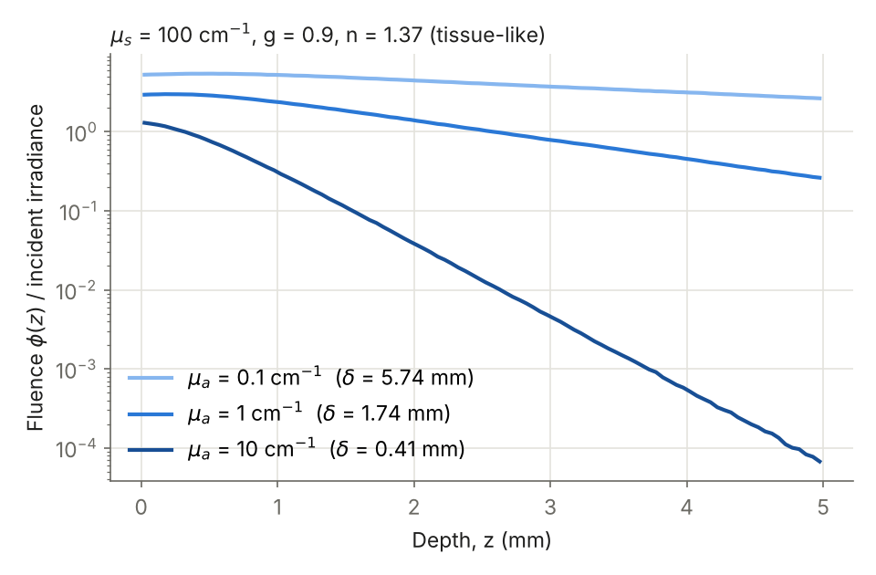

# tissue-optics-mc

Monte Carlo simulation of light transport in turbid media — the standard tool of
**tissue optics** — written in vectorized NumPy and validated against exact and
published results.

A pencil beam enters a slab (tissue, phantom, paint, foam…) characterized by its
absorption coefficient μa, scattering coefficient μs, anisotropy g and refractive
index n. The code follows thousands of photon packets through absorption, scattering
and Fresnel reflection at the boundaries, and returns:

- total diffuse reflectance **Rd**, transmittance **T**, absorbed fraction **A** and specular reflection
- spatially resolved reflectance **Rd(r)** — what a fiber-probe or camera measures
- absorbed energy and **fluence vs depth φ(z)** — how deep the light reaches

The algorithm is the one of MCML (Wang, Jacques & Zheng, 1995), but all packets are
propagated at once as NumPy arrays instead of one by one in C.





## Quick start

```bash
git clone https://github.com/jvelasquezc00-dot/tissue-optics-mc.git
cd tissue-optics-mc
pip install -e ".[examples,test]"
```

```python
from tissuemc import Medium, run

# Tissue-like slab, 2 mm thick, at a visible/NIR wavelength
skin = Medium(mua=1.0, mus=100.0, g=0.9, n=1.37, thickness=0.2)
res = run(skin, n_photons=100_000, seed=0)
print(res.summary())

res.r_centers, res.rd_r        # Rd(r) in 1/cm^2
res.z_centers, res.fluence_z   # φ(z) per unit incident irradiance
```

Reproduce the figures with `python examples/make_figures.py` and run the
validation suite with `pytest`.

## Validation

Every check lives in [`tests/test_validation.py`](tests/test_validation.py), with
tolerances set from the statistical error of the run.

| Case | Reference | Reference value | This code |
|---|---|---|---|
| Semi-infinite, a = 0.9, g = 0, n = 1 | Exact: R = 1 − H(1)·√(1−a), Chandrasekhar H-function (computed in `analytic.py`) | Rd = 0.41495 | Rd = 0.4143 ± 0.0004 |
| Slab μa = 10, μs = 90 cm⁻¹, g = 0.75, d = 0.2 mm, n = 1 | van de Hulst (1980); Prahl et al. (1989) | Rd = 0.09739, T = 0.66096 | Rd = 0.0979 ± 0.0008, T = 0.6610 ± 0.0010 |
| Rd(r) far from the source | Diffusion theory, dipole model (Farrell et al. 1992) | — | agreement within the diffusion regime (see figure) |
| Energy conservation | Rsp + Rd + T + A = 1 | 1 | 1.000 |
| Henyey–Greenstein sampling | ⟨cos θ⟩ = g | g | g ± 0.005 |

Diffusion theory fails near the source (r ≲ 1/μs′), which is exactly where Monte
Carlo is needed — the first figure shows both regimes.

## How it works

For each packet (weight starts at 1 − R_sp):

1. **Step**: s = −ln ξ / μt, with μt = μa + μs.
2. **Boundary**: if the step crosses a surface, the packet stops there and is
   internally reflected with probability R(θ) (unpolarized Fresnel, including total
   internal reflection) or escapes and is scored as reflectance or transmittance.
   The unused step is kept in units of mean free paths.
3. **Absorption**: the packet deposits the fraction μa/μt of its weight.
4. **Scattering**: new direction from the Henyey–Greenstein phase function.
5. **Russian roulette** below a weight threshold ends packets without bias.

## Project structure

```
tissuemc/core.py       Monte Carlo engine, Medium and SimulationResult
tissuemc/analytic.py   Chandrasekhar H-function and diffusion-theory references
tests/                 validation against exact and published results
examples/              script that generates the figures
```

## Possible extensions

- Multi-layer media (epidermis / dermis / subcutaneous fat)
- Wavelength-dependent optical properties from chromophore spectra (melanin, hemoglobin, water)
- Mie-theory inputs: μs and g computed from particle size and refractive index
- Time-resolved reflectance (photon time of flight)

## References

- L. Wang, S. L. Jacques, L. Zheng, "MCML — Monte Carlo modeling of light transport in multi-layered tissues", *Comput. Methods Programs Biomed.* 47, 131–146 (1995).
- S. A. Prahl, M. Keijzer, S. L. Jacques, A. J. Welch, "A Monte Carlo model of light propagation in tissue", *SPIE Institute Series* IS 5, 102–111 (1989).
- T. J. Farrell, M. S. Patterson, B. Wilson, "A diffusion theory model of spatially resolved, steady-state diffuse reflectance", *Med. Phys.* 19, 879–888 (1992).
- H. C. van de Hulst, *Multiple Light Scattering*, Academic Press (1980).
- S. Chandrasekhar, *Radiative Transfer*, Dover (1960).

## License

MIT — see [LICENSE](LICENSE).
