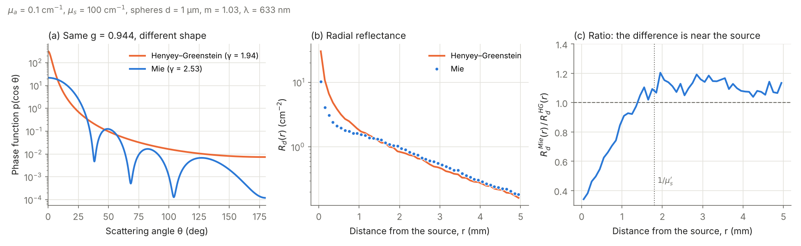

# tissue-optics-mc

Monte Carlo simulation of light transport in turbid media — the standard tool of
**tissue optics** — written in vectorized NumPy and validated against exact and
published results.

A pencil beam enters a slab (tissue, phantom, paint, foam…) characterized by its
absorption coefficient μa, scattering coefficient μs, anisotropy g and refractive
index n. The code follows thousands of photon packets through absorption, scattering
and Fresnel reflection at the boundaries, and returns:

- total diffuse reflectance **Rd**, transmittance **T**, absorbed fraction **A** and specular reflection
- spatially resolved reflectance **Rd(r)** — what a fiber-probe or camera measures
- absorbed energy and **fluence vs depth φ(z)** — how deep the light reaches

The algorithm is the one of MCML (Wang, Jacques & Zheng, 1995), but all packets are
propagated at once as NumPy arrays instead of one by one in C.


## Quick start

```bash
git clone https://github.com/jvelasquezc00-dot/tissue-optics-mc.git
cd tissue-optics-mc
pip install -e ".[examples,test]"
```

```python
from tissuemc import Medium, run

# Tissue-like slab, 2 mm thick, at a visible/NIR wavelength
skin = Medium(mua=1.0, mus=100.0, g=0.9, n=1.37, thickness=0.2)
res = run(skin, n_photons=100_000, seed=0)
print(res.summary())

res.r_centers, res.rd_r        # Rd(r) in 1/cm^2
res.z_centers, res.fluence_z   # φ(z) per unit incident irradiance
```

Reproduce the figures with `python examples/make_figures.py` and run the
validation suite with `pytest`.

## Validation

Every check lives in [`tests/test_validation.py`](tests/test_validation.py), with
tolerances set from the statistical error of the run.

| Case | Reference | Reference value | This code |
|---|---|---|---|
| Semi-infinite, a = 0.9, g = 0, n = 1 | Exact: R = 1 − H(1)·√(1−a), Chandrasekhar H-function (computed in `analytic.py`) | Rd = 0.41495 | Rd = 0.4143 ± 0.0004 |
| Slab μa = 10, μs = 90 cm⁻¹, g = 0.75, d = 0.2 mm, n = 1 | van de Hulst (1980); Prahl et al. (1989) | Rd = 0.09739, T = 0.66096 | Rd = 0.0979 ± 0.0008, T = 0.6610 ± 0.0010 |
| Rd(r) far from the source | Diffusion theory, dipole model (Farrell et al. 1992) | — | agreement within the diffusion regime (see figure) |
| Energy conservation | Rsp + Rd + T + A = 1 | 1 | 1.000 |
| Henyey–Greenstein sampling | ⟨cos θ⟩ = g | g | g ± 0.005 |

Diffusion theory fails near the source (r ≲ 1/μs′), which is exactly where Monte
Carlo is needed — the first figure shows both regimes.

The Mie module is validated in [`tests/test_mie.py`](tests/test_mie.py):

| Check | Reference | Result |
|---|---|---|
| Q_ext, Q_sca, g for four spheres (including absorbing ones) | miepython 3.3 (independent implementation) | agreement to 1e-9 relative |
| Small-sphere limit | Rayleigh: Q_sca = (8/3) x⁴ \|(m²−1)/(m²+2)\|², g → 0 | agreement to 1e-3 |
| Optical theorem | Q_ext = 4 Re S(0) / x² | agreement to 1e-10 |
| Tabulated phase function | ∫p dμ = 1 and ⟨cos θ⟩ = g | 1e-6 and 2e-4 |

## Does the shape of the phase function matter?

Henyey–Greenstein (HG) is the usual choice because it needs a single parameter, g.
But two phase functions with the same g can look very different. The figure below
compares HG with the exact Mie phase function of spheres 1 µm in diameter with
relative index m = 1.03 (organelles in cytoplasm) at 633 nm. Both simulations use
the **same μa, μs and g**, so the only difference is the shape of p(θ).



- **(a)** HG reaches g = 0.944 with a narrow forward spike plus a long tail of
  wide-angle scattering. Mie reaches the same g with a broad forward lobe and
  almost no backscattering (p(180°) is about 60 times lower).
- **(b, c)** Near the source, a photon must turn around after only a few events to
  come back out, and that needs large-angle scattering. HG has more of it, so it
  predicts a reflectance up to ~3 times higher than Mie at r ≈ 0. The curves cross
  at r ≈ 1.5 mm, close to one transport mean free path (1/μs′ = 1.8 mm). Beyond it,
  Mie stays 5–15 % higher, a gap that shrinks with distance and with lower absorption.
- The total diffuse reflectance barely changes (0.6744 vs 0.6701), as expected from
  the similarity relation: integrated and far-field quantities depend mostly on
  μs′ = μs(1 − g).

The parameter γ = (1 − g₂)/(1 − g), where g₂ is the second Legendre moment of the
phase function, summarizes this: here γ = 1.94 for HG and 2.53 for Mie, and a higher γ
means fewer short, backward paths and lower reflectance close to the source
(Bevilacqua & Depeursinge, 1999). This is why HG can bias measurements made with
small source–detector separations, such as fiber probes in contact with tissue.

```python
from tissuemc import Medium, MiePhaseFunction, run
from tissuemc.mie import size_parameter

x = size_parameter(diameter_um=1.0, wavelength_um=0.633, n_medium=1.36)
pf = MiePhaseFunction(m=1.03, x=x)
medium = Medium(mua=0.1, mus=100.0, g=pf.g)
res = run(medium, 200_000, phase=pf)
```

Reproduce the figure with `python examples/mie_vs_hg.py`.

## How it works

For each packet (weight starts at 1 − R_sp):

1. **Step**: s = −ln ξ / μt, with μt = μa + μs.
2. **Boundary**: if the step crosses a surface, the packet stops there and is
   internally reflected with probability R(θ) (unpolarized Fresnel, including total
   internal reflection) or escapes and is scored as reflectance or transmittance.
   The unused step is kept in units of mean free paths.
3. **Absorption**: the packet deposits the fraction μa/μt of its weight.
4. **Scattering**: new direction from the Henyey–Greenstein phase function (sampled
   analytically) or from a Mie phase function (sampled by inverting its tabulated
   cumulative distribution).
5. **Russian roulette** below a weight threshold ends packets without bias.

## Project structure

```
tissuemc/core.py       Monte Carlo engine, Medium and SimulationResult
tissuemc/analytic.py   Chandrasekhar H-function and diffusion-theory references
tissuemc/mie.py        Mie theory for spheres and a sampleable Mie phase function
tests/                 validation against exact and published results
examples/              scripts that generate the figures
```

## Possible extensions

- Multi-layer media (epidermis / dermis / subcutaneous fat)
- Wavelength-dependent optical properties from chromophore spectra (melanin, hemoglobin, water)
- μs from particle concentration (μs = N π a² Q_sca) and polydisperse size distributions
- Time-resolved reflectance (photon time of flight)

## References

- L. Wang, S. L. Jacques, L. Zheng, "MCML — Monte Carlo modeling of light transport in multi-layered tissues", *Comput. Methods Programs Biomed.* 47, 131–146 (1995).
- S. A. Prahl, M. Keijzer, S. L. Jacques, A. J. Welch, "A Monte Carlo model of light propagation in tissue", *SPIE Institute Series* IS 5, 102–111 (1989).
- T. J. Farrell, M. S. Patterson, B. Wilson, "A diffusion theory model of spatially resolved, steady-state diffuse reflectance", *Med. Phys.* 19, 879–888 (1992).
- H. C. van de Hulst, *Multiple Light Scattering*, Academic Press (1980).
- S. Chandrasekhar, *Radiative Transfer*, Dover (1960).
- C. F. Bohren, D. R. Huffman, *Absorption and Scattering of Light by Small Particles*, Wiley (1983).
- F. Bevilacqua, C. Depeursinge, "Monte Carlo study of diffuse reflectance at source–detector separations close to one transport mean free path", *J. Opt. Soc. Am. A* 16, 2935–2945 (1999).

## License

MIT — see [LICENSE](LICENSE).
